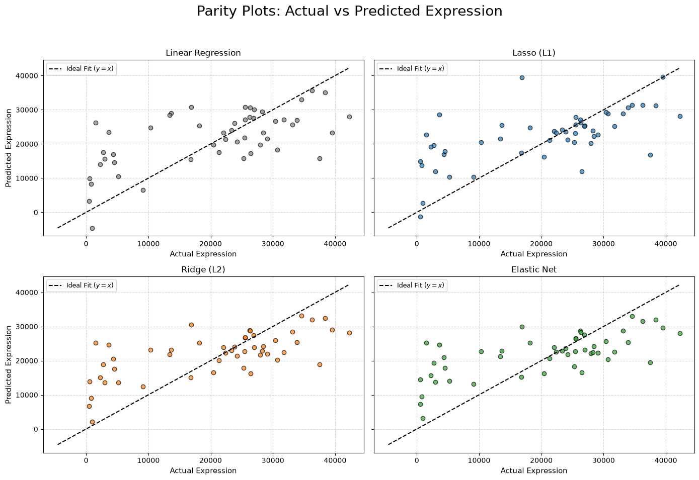
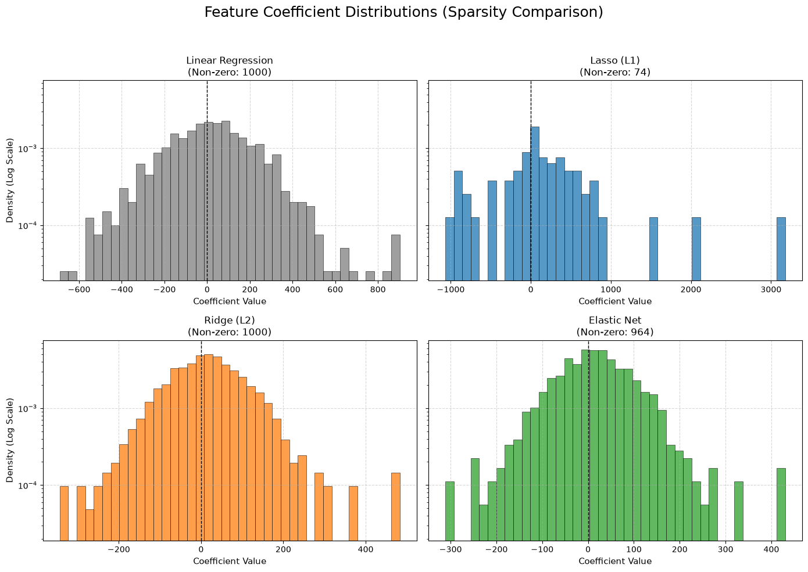

# Comparing Regression and Regularization Techniques Using Lung Adenocarcinoma Gene-Expression Data

[](https://www.python.org/)
[](https://scikit-learn.org/)
[](https://www.ncbi.nlm.nih.gov/geo/query/acc.cgi?acc=GSE31210)

## Project Overview

This project explores the application of regression and regularization techniques to high-dimensional gene-expression data from lung adenocarcinoma (LUAD) samples.

Using the GSE31210 dataset, four regression approaches are compared:

- Ordinary Least Squares (OLS) Linear Regression
- Lasso Regression (L1 regularization)
- Ridge Regression (L2 regularization)
- Elastic Net Regression

The objective is to understand how regularization influences predictive performance, coefficient shrinkage, and model sparsity when working with high-dimensional biological data.

The project was undertaken as a practical exercise to apply machine-learning concepts to a biological dataset.

> **Disclaimer:** This is a machine-learning learning project, not a biological research study. The analysis is intended to compare regression methods and their behaviour on gene-expression data. It does not aim to identify validated biomarkers, establish biological relationships, or make clinical predictions.

## Dataset

**GEO Accession:** [GSE31210](https://www.ncbi.nlm.nih.gov/geo/query/acc.cgi?acc=GSE31210)

- **Data type:** Gene-expression microarray data
- **Platform:** Affymetrix Human Genome U133 Plus 2.0 Array (GPL570)
- **Samples:** 246 lung adenocarcinoma samples
- **Original expression features:** 54,675 Affymetrix probes

The expression matrix was loaded from the GEO Series Matrix file and transposed so that samples represented rows and probes represented columns.

### Target Variable

The expression signal from Affymetrix probe `218835_at` was selected as the continuous target variable for regression.

This probe was selected because it exhibited the highest expression variance across the samples (approximately 1.17 × 10⁸).

According to the GPL570 platform annotation, probe `218835_at` maps to *SFTPA1 /// SFTPA2*. It cannot be uniquely assigned to either gene.

The remaining expression probes were used as predictors.

## Methodology

The analysis followed these steps:

1. **Data Loading and Inspection:** Loaded the GSE31210 expression matrix and examined its dimensions, structure, missing values, and feature names.
2. **Control Probe Removal:** Removed 62 Affymetrix control probes whose IDs begin with `AFFX-`, leaving 54,613 expression probes.
3. **Target and Predictor Separation:** Selected probe `218835_at` as the target and excluded it from the predictor matrix.
4. **Train-Test Split:** Divided the data into training (80%, 196 samples) and test (20%, 50 samples) sets using `random_state=42`.
5. **Feature Selection:** Selected the 1,000 highest-variance predictor probes using the training data only. The same probes were retained in the test data.
6. **Feature Standardization:** Applied `StandardScaler`, fitting it on the training data and using the fitted scaler to transform the test data.
7. **Model Development:** Trained OLS, Lasso, Ridge, and Elastic Net regression models. Five-fold cross-validation was used to select regularization parameters for Lasso, Ridge, and Elastic Net.
8. **Model Evaluation:** Compared test-set Mean Squared Error (MSE), R², and the number of non-zero coefficients.
9. **Visual Analysis:** Examined actual versus predicted expression values, prediction summaries, and coefficient distributions to understand model performance and sparsity.

## Model Performance

The four models were evaluated on the same held-out test set of 50 samples.

| Model | Non-zero Coefficients | Test MSE | Test R² |
|---|---:|---:|---:|
| Ridge (L2) | 1,000 | 8.571923 × 10⁷ | **0.4225** |
| Elastic Net | 964 | 8.613904 × 10⁷ | 0.4197 |
| Lasso (L1) | 74 | 9.121291 × 10⁷ | 0.3855 |
| Linear Regression (OLS) | 1,000 | 9.204392 × 10⁷ | 0.3799 |

### Key Observations

- **Ridge Regression:** Achieved the best test-set performance, with an R² of 0.4225. It retained all 1,000 coefficients while shrinking their magnitudes.
- **Elastic Net:** Achieved performance close to Ridge, with an R² of 0.4197, while retaining 964 non-zero coefficients.
- **Lasso Regression:** Produced the sparsest model, retaining only 74 non-zero coefficients out of 1,000 predictors. Its predictive performance was lower than Ridge and Elastic Net.
- **Linear Regression:** Served as the unregularized baseline and had the highest test MSE and lowest R² among the four models.

These results illustrate a trade-off between predictive performance and model sparsity. In this experiment, Ridge provided the best predictive performance, whereas Lasso achieved the greatest reduction in model complexity.

## Coefficient Distribution and Sparsity

The coefficient distributions were visualized using histograms to compare how the four models handle predictor coefficients.

The analysis illustrates the differences between:

- Lasso's ability to shrink some coefficients exactly to zero.
- Ridge's tendency to shrink coefficient magnitudes without generally eliminating predictors.
- Elastic Net's combination of L1 and L2 regularization.
- OLS, which estimates coefficients without regularization.

The coefficient analysis provides a visual complement to the numerical comparison of non-zero coefficients.

## Discussion and Limitations

The results are specific to the selected target probe, dataset, model configurations, and train-test split. They should not be interpreted as evidence of biological regulation or gene-level significance.

The project has the following limitations:

- **Single dataset:** The analysis uses only GSE31210.
- **Internal evaluation:** The held-out test samples come from the same dataset. Independent external validation has not been performed.
- **Cross-validation preprocessing:** Feature selection and standardization were performed using the training data before internal cross-validation. Placing these preprocessing steps inside a cross-validation pipeline would provide a more rigorous approach to hyperparameter selection.
- **Biological interpretation:** The project does not establish gene-specific biological relationships, identify validated biomarkers, or demonstrate clinical predictive value.

### Connection to Published Literature

Xu et al. (2024) emphasised the importance of comparing multiple machine-learning algorithms and validating bioinformatics-based cancer models using independent clinical cohorts.

This project follows the algorithm-comparison aspect of that recommendation by evaluating OLS, Lasso, Ridge, and Elastic Net. The observed difference between Ridge's predictive performance and Lasso's sparsity also illustrates why model evaluation should consider more than one performance measure.

However, this exercise does not include external clinical validation or an assessment of clinical predictive gain.

## Key Findings and Visualizations

### 1. Actual vs Predicted Expression (Parity Plots)

The parity plots compare the actual and predicted expression values for each regression model. The diagonal reference line represents perfect predictions.

Ridge and Elastic Net showed relatively better predictive performance than Lasso and Linear Regression in this experiment.



### 2. Coefficient Distributions

The coefficient distributions illustrate how the four regression approaches influence model coefficients.

- **Lasso:** Retained 74 non-zero coefficients, producing the sparsest model.
- **Ridge:** Retained all 1,000 coefficients while shrinking their magnitudes.
- **Elastic Net:** Retained 964 non-zero coefficients.
- **Linear Regression:** Retained all 1,000 coefficients without regularization.

These results demonstrate the differences in coefficient shrinkage and sparsity across the models.



## Technologies and Libraries

- Python
- NumPy
- Pandas
- Matplotlib
- Scikit-learn
- Jupyter Notebook


## Installation and Usage

### 1. Clone the repository

```bash
git clone https://github.com/polz24/luad-ml-regularization.git
cd luad-ml-regularization
```

### 2. Create and activate a virtual environment

```bash
python -m venv venv
```

On macOS/Linux:

```bash
source venv/bin/activate
```

On Windows:

```bash
venv\Scripts\activate
```

### 3. Install the required libraries

```bash
pip install -r requirements.txt
```

If running the optional enrichment-analysis cells, install `gprofiler-official` as well.

### 4. Obtain the dataset

Download the GSE31210 Series Matrix file from the [NCBI GEO dataset page](https://www.ncbi.nlm.nih.gov/geo/query/acc.cgi?acc=GSE31210).

Place the downloaded file in the `geo_cache` directory, following the path expected by the notebook:

```text
./geo_cache/GSE31210_series_matrix.gz
```

### 5. Run the notebook

Launch Jupyter:

```bash
jupyter notebook
```

Open:

`01_LUAD_Gene_Expression_Regression_Regularization.ipynb`

Run the notebook cells in sequence.

## References

1. **GSE31210:** NCBI Gene Expression Omnibus. [Lung adenocarcinoma gene-expression dataset](https://www.ncbi.nlm.nih.gov/geo/query/acc.cgi?acc=GSE31210).

2. **Xu, F., Li, Z., Guan, H., & Ma, J. (2024).** Multiple machine learning algorithms, validation of external clinical cohort and assessments of model gain effects will better serve cancer research on bioinformatic models. *Cancer Cell International, 24*, 427. [https://doi.org/10.1186/s12935-024-03601-0](https://doi.org/10.1186/s12935-024-03601-0).

---

*This project represents a learning exercise in applying machine-learning techniques to biological data and understanding the challenges of modelling high-dimensional datasets.*